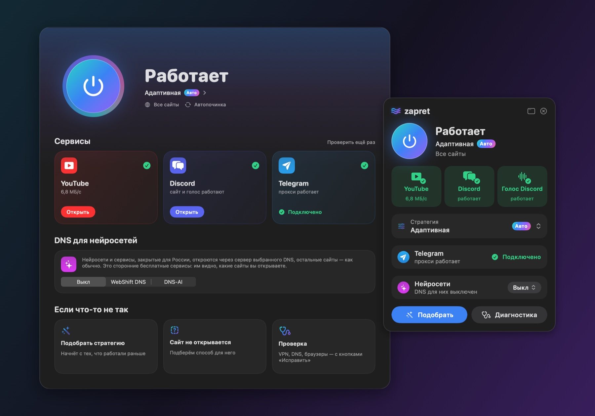

# zapret for macOS

**YouTube, Discord and Telegram on a Mac — as if nobody were in the way.** 
An app with its own engine: it finds a way for every site by itself and keeps it working.

### [Download zapret.dmg](https://github.com/slow-ball/zapret-macos/releases/latest)

[Русский](README.md) · English

## What it is

Providers slow down and break connections by the site's name in their first packets. zapret changes those
packets so the provider's filter can't read them while the site still can. No VPN: traffic goes directly,
through no third-party servers and with no loss of speed.

One button turns it on — in the menu bar, in a widget or <kbd>⌃⌥Z</kbd>. Nothing else to set up.

## What makes it different

- **It adapts to every site.** Instead of one setting for everything, a ladder of tricks lives in the
  engine itself. When the provider breaks a site, the engine moves it to the next trick at once and
  remembers the one that worked. Separately for ordinary sites, for QUIC and for Discord voice.
- **It picks the fastest way on the go.** The engine measures the speed the browser really gets, now and
  then tries other tricks on a share of connections and moves the site to a clearly faster one.
  Every group of YouTube's video servers has a trick of its own.
- **It learns by itself.** Once a day the trick most sites chose moves to the start of the ladder, and the
  bad ones give way to new ones the generator makes from the best.
- **It touches only what is blocked.** YouTube, Discord, Telegram, your sites, the sites known to be blocked
  and the ones that didn't open without a bypass get it — the engine finds those itself. The rest of the
  internet, banks and government services go as they are, nothing breaks.
- **Its own Telegram proxy.** Built in, one button: directly through Telegram's web servers, and where those
  are closed — through the community's relays on Cloudflare.
- **DNS for neural networks** — for services that are closed for Russia by themselves. Only turned on by hand.
- **It looks after itself.** It survives Wi-Fi changes, sleep, VPN and macOS updates, repairs itself, gets
  fresh strategies every day, updates without a password — and only with signed versions.

## Installation

1. Download **[zapret.dmg](https://github.com/slow-ball/zapret-macos/releases/latest)** and drag zapret to Applications.
2. Open zapret. If macOS refuses: **System Settings → Privacy & Security → "Open Anyway"** (once — see below why).
3. Click **Install** and enter your Mac's password. Restart the browser.

With [Homebrew](https://brew.sh): `brew install --cask slow-ball/tap/zapret`

## If something doesn't open

**Sites → "A site doesn't open?"** — in a few seconds zapret tells what it is: the provider, DNS, a blocked
address or the service itself — and finds a way for that very site. The **Adaptation** page shows the trick
of every site and why it changed.

Still stuck — **Checks → Report a problem**: a ready report opens, with IP addresses and names removed.

## Questions

Does it work together with a VPN?

Yes. While the VPN is on, traffic goes through it; turn it off and zapret carries on at once.

Why won't macOS open the app?

Apple's signature needs a paid account in a real name, and the project is anonymous. The app is built in the
open, by GitHub Actions from this repository. Opening it has to be allowed once.

Is it safe?

Everything zapret downloads is checked: updates by the project's signing key, the engine and the app by
checksums pinned in the code. The app itself compares the installed files with the signed release. The
password is needed once, for the macOS firewall rules; after that the app runs zapret without a password,
but only through a fixed set of commands. The engine runs without root.

The Telegram proxy decrypts nothing: the data is encrypted by Telegram itself. The DNS for neural networks
are third-party free services (WebShift DNS, DNS-AI): they see which sites you open.

Does it slow the internet down?

No. The engine touches only the first packets of a connection, the rest passes as it is. If the provider
slows a service down as a whole — by its addresses, not by the site's name — no packet trick lifts that,
and zapret says so honestly in "A site doesn't open?".

What goes where, and how to remove it?

The app goes to Applications, the project folder with your own lists of sites to `~/zapret-macos`, the
system part to `/opt/zapret-macos` and the services `com.zapret-macos.*`. To remove: **Settings → Remove…**
— everything goes, the firewall rules too.

For the advanced: the Terminal

`~/zapret-macos/zapret.command` — the menu, `~/zapret-macos/src/zapret.sh help` — all the commands.
How the project works and how to build it — in [ARCHITECTURE.md](ARCHITECTURE.md) (in Russian).

## Thanks

The engine grew out of [zapret](https://github.com/bol-van/zapret) (bol-van) and the macOS port of nfqws by
[Flowseal](https://github.com/Flowseal/zapret-mac-discord-youtube). The Windows version's strategies and the
Telegram relays come from [Flowseal](https://github.com/Flowseal) and its community. License — [MIT](LICENSE).
